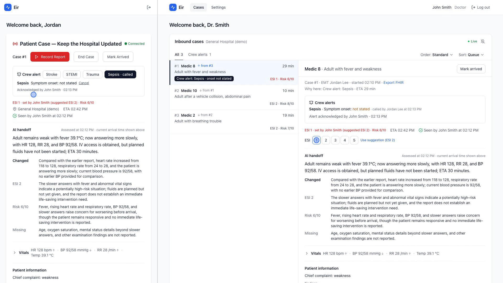
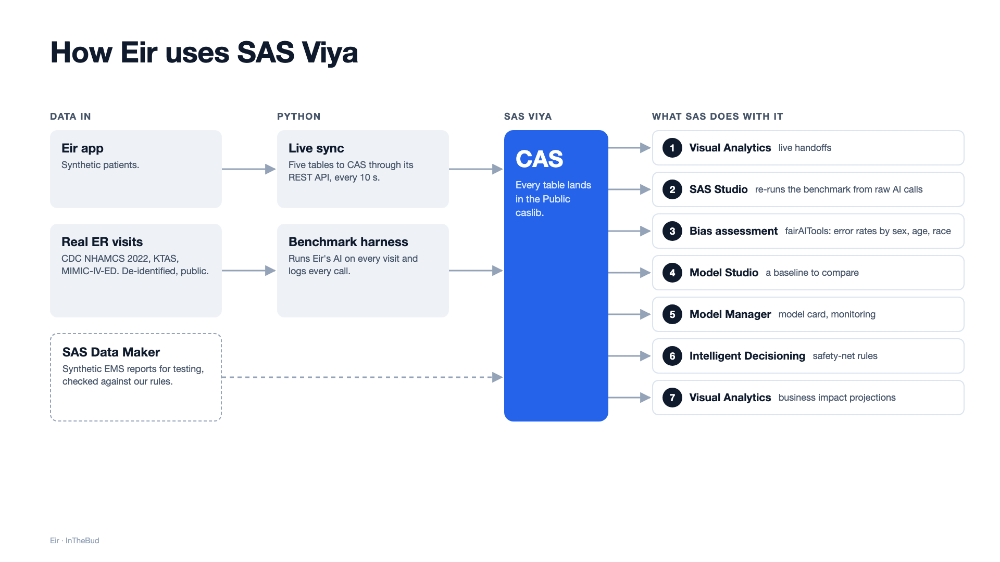

# Eir

[](https://www.sas.com/en_us/events/hackathon.html) [](requirements.txt) [](client/package.json) [](LICENSE)

Eir gives the receiving hospital the full picture of an incoming ambulance patient before the ambulance arrives. Team InTheBud built it for the SAS Hackathon 2026.

An EMS crew talks the way they already do. Eir writes the report down, pulls out the vitals and findings with the exact words they came from, and suggests an Emergency Severity Index level with its reasoning. The hospital sees every inbound patient on one screen, in an order it can explain, and acknowledges what it has read. The clinician makes the triage call. Every suggestion and every change is kept in SAS Viya, so a hospital can check the AI, trace each decision and watch its performance over time.



## What it does

- **Live handoff.** The crew records a report on the medic app and the hospital sees the words within about a second. The complete report is transcribed again on send, and only that transcript feeds the AI.
- **Facts with provenance.** Vitals, findings and treatments are extracted into structured fields, each quoting the words it came from. A number that does not appear in the report is flagged. Hovering a value on the dashboard shows its source.
- **Suggested severity.** Each new piece of information gets a short handoff, an ESI level (1 to 5, or Cannot assess) and a risk score, all with reasons. A doctor can change the level with one tap, and nothing is overwritten.
- **An explainable queue.** Inbound patients are ordered by a stated rule: unacknowledged information and crew alerts first, then expected arrival. The AI level can be added to the ordering per hospital, and every change to the order is recorded with its cause.
- **Crew alerts and messaging.** Stroke, STEMI, trauma and sepsis alerts with their key times, acknowledged separately from the reports, plus a message thread per case.
- **Hospital record export.** The handoff exports as a FHIR R4 bundle, with a provenance entry for each extracted fact.

## How SAS Viya is used



| SAS component | Role in Eir |
|---|---|
| CAS | The app pushes five structured tables (cases, events, assessments, queue changes, vitals) every 10 seconds. Transcripts and notes stay in the app. |
| Visual Analytics | A live dashboard of inbound cases, AI results and queue history, joined to the evaluation data by case id. |
| SAS Studio | The Python benchmark recomputed with PROC FREQ, plus fairness tests by sex, age band and, on US data, race and ethnicity. |
| Model Studio | A gradient boosting baseline on age, vitals and mental state, for comparison with the language model that reads the whole report. |
| Model Manager | The model card (purpose, inputs, limits) and performance monitoring across the three evaluation sets. |
| Intelligent Decisioning | A safety net written as plain rules: follow the AI level when there is one; when there is not, flag the patient urgent on a stated vital sign in the danger zone. |
| Data Maker | 1,000 synthetic EMS reports generated from a fictional table, scored for similarity and disclosure risk, used to test the app and kept separate from the benchmark. |

## Evaluation

The AI was run on real, de-identified emergency department visits from three public data sets: CDC NHAMCS 2022 (1,683 adult ambulance arrivals from 129 US hospitals), KTAS (Moon et al., 2019) and the MIMIC-IV-ED demo. The analysis plan was committed before any model call ([protocol](evals/benchmark/PROTOCOL.md)); every result is stored in CAS. Critical means the patient went to intensive care, had surgery or died.

| Data set | Result |
|---|---|
| 1,683 ambulance arrivals, CDC NHAMCS | Of 155 critical patients, Eir placed 110 in its top two levels, held 38 for a clinician to review and placed 7 lower. |
| 154 expert-rated critical or emergent patients, KTAS | 138 in the top two levels, 14 held for review, 2 placed lower. |
| 74 urgent patients, held-out set | Eir caught 63 (9 held, 2 missed) against 53 for the gradient boosting baseline at the same false-alarm rate. |
| All sets, 4,884 assessments | Median 2.9 seconds per assessment, $1.09 in total. The number check caught all 23,684 planted wrong numbers, and 10,232 of 10,233 vital signs were read correctly. |

Eir leans urgent: on US patients who were later sent home, it placed 56 percent in its top two levels against 22 percent for ED triage. On US data the fairness tests found no significant gap by sex, age or race; in the expert-rated set, patients under 65 were held for review more often than older ones. The full [report](evals/benchmark/results/REPORT.md), [model card](evals/benchmark/results/MODEL_CARD.md) and [data sources and licences](evals/benchmark/results/SOURCES.md) are in `evals/benchmark/`, with the harness that reproduces them; the SAS scripts are in [sas/](sas/).

## Team

- Ishaan, team lead
- Vrishank, evaluation against expert triage decisions on real ED data
- Dhananjay (DJ), vital-sign extraction and the hospital queue
- Anand, live transcription, messaging and the clinician interface
- Mayank, SAS Viya data pipeline and the Visual Analytics dashboard

## Run it

Python 3 with SQLite 3.35 or newer, Node.js 16 or newer, and an OpenAI API key for transcription and the AI steps.

```bash
python3 -m venv .venv
.venv/bin/pip install -r requirements.txt
.venv/bin/python main.py                 # API on http://localhost:5000
cd client && npm ci && npm start         # React client on http://localhost:3000
```

Settings come from the environment or a `.env` file: `JWT_SECRET`, `OPENAI_API_KEY`, and `SEED_DEMO_USERS=1` to create the demo accounts. The three-patient demo replay and the presenter's run sheet are in [demo/](demo/README.md).

```bash
.venv/bin/python -m pytest tests                              # backend, no API keys needed
cd client && CI=true npm test -- --watchAll=false --runInBand  # client
```

## Repository

- `backend/` the case model, AI steps, queue, FHIR export and SAS sync, with the API under `backend/routes/`
- `client/` the React app for crews and hospitals
- `evals/` the evaluation harness, prompts and contracts; `evals/benchmark/` the protocol, cases, scoring and results
- `sas/` SAS Viya scripts, the CAS notebook and the Data Maker evaluation
- `datamaker_test/` the fictional source table for Data Maker and its validator
- `demo/` the replay and run sheet
- `tests/` the backend tests
- `docs/` the [technical reference](docs/technical-reference.md) (settings, data model, API, SAS sync, known limits), the architecture review and the clinician annotation materials

## License

MIT. See [LICENSE](LICENSE).
